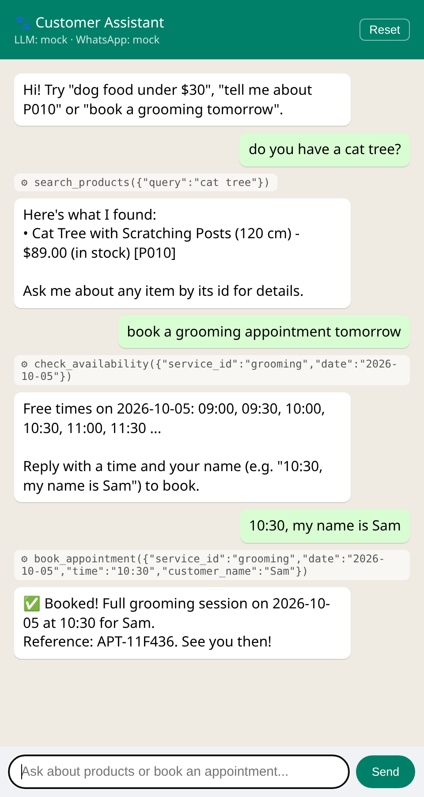
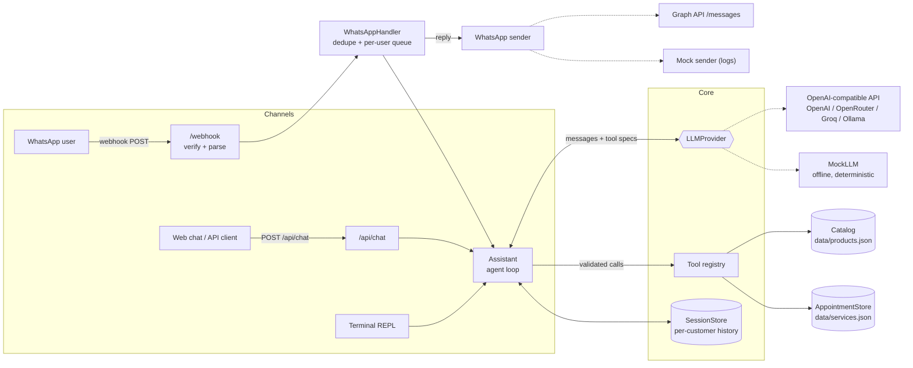
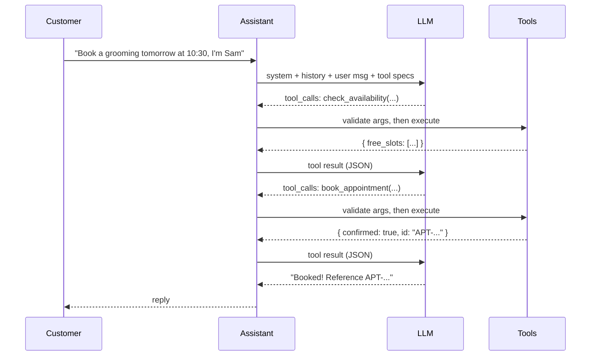

# WhatsApp AI Assistant

[](https://github.com/HamataKhaireddine/whatsapp-ai-assistant/actions/workflows/ci.yml)


An **LLM-powered customer assistant** for **WhatsApp and the web** that can **search a product catalog, answer product questions and book appointments**, built on the **function-calling (tool-use)** pattern.

It works with **any OpenAI-compatible API** (OpenAI, OpenRouter, Groq, Together, Ollama, vLLM, ...) and ships with an **offline mock mode**, so you can run it, chat with it and run the full test suite **without a WhatsApp account or any paid API key**.

> **Background.** This is an open-source, from-scratch demo inspired by a production chatbot I built for a client (WhatsApp + website, product search and appointment booking). That client project is private, so **none of its code or data is in this repo**. Everything here, including the sample pet-store catalog, was written for this demo.

---

## Demo

<p align="center">
  
</p>

<!-- TODO: add docs/demo-whatsapp.png (or a GIF) of the bot on a WhatsApp test number - see docs/README.md -->

A terminal session in offline mock mode (`npm run chat`):

```text
you > dog food under $30
  ⚙ search_products({"max_price":30,"query":"dog food"})
bot > Here's what I found:
      • Puppy Starter Kibble (3 kg) - $19.50 (in stock) [P002]

you > tell me about P010
  ⚙ get_product_details({"product_id":"P010"})
bot > Cat Tree with Scratching Posts (120 cm) - $89.00
      Three-level cat tree with sisal-wrapped posts, a hideaway condo and a plush top perch.
      In stock (4 left).

you > I want to book a grooming appointment
bot > Sure - what date would you like for the grooming appointment?

you > tomorrow
  ⚙ check_availability({"service_id":"grooming","date":"2026-10-05"})
bot > Free times on 2026-10-05: 09:00, 09:30, 10:00, 10:30, 11:00, 11:30 ...

you > 10:30, my name is Sam
  ⚙ book_appointment({"service_id":"grooming","date":"2026-10-05","time":"10:30","customer_name":"Sam"})
bot > ✅ Booked! Full grooming session on 2026-10-05 at 10:30 for Sam.
      Reference: APT-08EB3C. See you then!
```

## Features

- 🛍️ **Product search and Q&A.** Keyword relevance search with category, price and stock filters, plus per-product details.
- 📅 **Appointment booking.** Opening hours, closed days, service durations, overlap detection, no past slots, and a "N days ahead" limit.
- 🧠 **Tool-calling agent loop.** The model decides which tool to call, the app validates and runs it, and the results go back to the model. Several tool calls can run in one round.
- 🔌 **Provider-agnostic LLM layer.** Plain `fetch` against `/chat/completions`, with no SDK lock-in. Switching provider means changing the base URL and model.
- 💬 **WhatsApp Cloud API.** Webhook verification, `X-Hub-Signature-256` validation, message parsing (text and buttons), replies, read receipts, de-duplication of Meta retries, and 4096-char chunking.
- 🌐 **Web chat and REST API.** A tiny chat UI at `/` (the "website widget" side) and `POST /api/chat`.
- 🧪 **Offline by design.** A deterministic `MockLLM` and a mock WhatsApp sender. 48 tests run with no network.
- 🪶 **Zero runtime dependencies.** Only Node built-ins (`node:http`, `fetch`, `crypto`). The dev dependencies are TypeScript, tsx and @types/node.

## Architecture



```
src/
├── index.ts                 # HTTP server entry point
├── cli.ts                   # terminal chat (REPL)
├── app.ts                   # composition root (dependency injection)
├── server.ts                # node:http routes: web chat, REST API, WhatsApp webhook
├── config.ts                # env parsing + validation
├── assistant/
│   ├── assistant.ts         # agent loop (LLM <-> tools)
│   ├── prompt.ts            # system prompt
│   └── sessions.ts          # conversation memory with TTL + safe trimming
├── llm/
│   ├── types.ts             # provider-agnostic message/tool types
│   ├── openai-compatible.ts # fetch-based client with timeout + retries
│   └── mock.ts              # offline rule-based "LLM" that emits real tool calls
├── tools/
│   ├── types.ts             # Tool interface, JSON-schema spec, arg validation
│   └── index.ts             # the 5 tools
├── stores/
│   ├── catalog.ts           # product search
│   └── appointments.ts      # availability + bookings
├── channels/whatsapp/
│   ├── webhook.ts           # verify handshake, signature check, payload parsing
│   ├── client.ts            # Cloud API sender + mock sender
│   └── handler.ts           # dedupe, per-sender ordering, reply
└── web/page.ts              # minimal chat UI
data/                        # sample catalog + services (demo data)
test/                        # node:test suites (all offline)
```

## Tool-calling design

The assistant exposes five tools to the model, described as JSON Schema in the standard OpenAI `tools` format:

| Tool | Purpose | Required args |
|---|---|---|
| `search_products` | Keyword search with optional `category`, `max_price`, `in_stock_only` | none |
| `get_product_details` | Full details for one product id | `product_id` |
| `list_services` | Bookable services with duration and price | none |
| `check_availability` | Free start times for a service on a date | `date`, `service_id` |
| `book_appointment` | Create a booking after the customer confirms | `date`, `time`, `service_id`, `customer_name` |

**The loop** (`src/assistant/assistant.ts`):



Design choices:

- **The model never sees or invents data directly.** Prices, stock and slots always come from tools, and the system prompt says so.
- **Arguments are validated at runtime** (required fields, types, enums, unknown keys) before any handler runs. Models do produce bad arguments.
- **Errors are returned to the model as data, not thrown.** For example, `{"error": "10:30 is not available. Free slots: ..."}` lets the model recover and offer alternatives.
- **The loop is bounded** (`maxToolRounds`, default 5). On the last round, tools are withheld so the model has to answer in text.
- **History stays consistent.** A failed turn is not persisted, and history is trimmed only at user-message boundaries, so a `tool` message never loses its `tool_call`.
- **Channel context** (WhatsApp number, web session) reaches tools through `ToolContext`. For example, a booking defaults its contact to the WhatsApp sender.

Adding a tool means adding a `{ name, description, parameters, handler }` object in `src/tools/index.ts`.

## Getting started

Requirements: **Node.js 20.12+**.

```bash
git clone https://github.com/HamataKhaireddine/whatsapp-ai-assistant.git
cd whatsapp-ai-assistant
npm install
npm test          # 48 offline tests
```

### 1. Offline mode (no API key, no WhatsApp)

With no `OPENAI_API_KEY` set, the app uses `MockLLM`. This is a deterministic, rule-based stand-in that speaks the same tool-calling protocol as a real model, so the whole pipeline (agent loop, tools, stores, WhatsApp layer) runs for real.

```bash
npm run chat      # terminal chat (add -- --verbose to see logs)
npm start         # web chat on http://localhost:3000 + REST API + webhook
```

```bash
curl -s localhost:3000/api/chat -H 'content-type: application/json' \
  -d '{"message":"do you have a cat tree?"}'
# -> { "sessionId": "...", "reply": "...", "toolCalls": [ { "name": "search_products", ... } ] }
```

> The mock understands simple phrasings ("dog food under $30", "P010", "book a nail trim tomorrow at 3pm, my name is Lina"). It is meant for demos and tests. For natural conversation, plug in a real model.

### 2. With a real LLM

```bash
cp .env.example .env
# set OPENAI_API_KEY (and optionally OPENAI_BASE_URL / OPENAI_MODEL)
npm start
```

Any OpenAI-compatible endpoint works if the model supports tool calling:

| Provider | `OPENAI_BASE_URL` | Example `OPENAI_MODEL` |
|---|---|---|
| OpenAI | `https://api.openai.com/v1` | `gpt-4o-mini` |
| OpenRouter | `https://openrouter.ai/api/v1` | any tool-capable model |
| Groq | `https://api.groq.com/openai/v1` | a tool-capable Llama model |
| Ollama (local, free) | `http://localhost:11434/v1` | `llama3.1`, `qwen2.5` |

For a local Ollama endpoint, no API key is needed: set `LLM_PROVIDER=openai` and `OPENAI_BASE_URL=http://localhost:11434/v1`.

### 3. Production build

```bash
npm run build && npm run start:prod
```

## Environment variables

| Variable | Default | Description |
|---|---|---|
| `LLM_PROVIDER` | `openai` if a key is set, else `mock` | `openai` (any compatible API) or `mock` |
| `OPENAI_API_KEY` | none | API key for the LLM endpoint. **Never commit it.** |
| `OPENAI_BASE_URL` | `https://api.openai.com/v1` | Base URL of any OpenAI-compatible API |
| `OPENAI_MODEL` | `gpt-4o-mini` | Model name |
| `LLM_TIMEOUT_MS` | `30000` | Per-request timeout (429/5xx are retried with backoff) |
| `PORT` | `3000` | HTTP port |
| `BUSINESS_NAME` | `Pawsome Pet Supplies` | Used in the system prompt |
| `WHATSAPP_ACCESS_TOKEN` | none | Cloud API token. If empty, replies are logged instead of sent |
| `WHATSAPP_PHONE_NUMBER_ID` | none | Sender phone number id |
| `WHATSAPP_VERIFY_TOKEN` | `change-me` | Your chosen webhook verify token |
| `WHATSAPP_APP_SECRET` | none | Enables `X-Hub-Signature-256` verification (recommended) |
| `WHATSAPP_API_VERSION` | `v21.0` | Graph API version |

## WhatsApp Cloud API setup

1. Create an app at [developers.facebook.com](https://developers.facebook.com/) and add the **WhatsApp** product. Meta gives you a test number and lets you message a few verified recipients for free.
2. From **WhatsApp > API Setup**, copy the **temporary access token** and the **Phone number ID** into `.env`. For production, create a **System User** permanent token.
3. Copy the **App secret** from **App settings > Basic** into `WHATSAPP_APP_SECRET`.
4. Expose your local server over HTTPS, for example with `ngrok http 3000` or `cloudflared tunnel --url http://localhost:3000`.
5. In **WhatsApp > Configuration > Webhook**, set the callback URL to `https://<your-tunnel>/webhook` and the verify token to your `WHATSAPP_VERIFY_TOKEN`. Then subscribe to the **`messages`** field.
6. Send a message to the test number. The server acknowledges the webhook immediately with `200`, processes the message asynchronously, and replies through the Graph API.

Notes:

- Outside the 24-hour customer-service window, WhatsApp only allows pre-approved **template messages**. This demo replies to inbound messages, so it always stays inside the window.
- Meta retries webhooks that aren't acknowledged quickly. The handler de-duplicates by message id and processes each sender's messages in order.
- To test the webhook without Meta, POST a sample payload yourself (see `textWebhook()` in `test/helpers.ts`) while `WHATSAPP_ACCESS_TOKEN` is empty. The reply shows up in the server log.

## Testing

```bash
npm test            # node:test, fully offline
npm run typecheck   # tsc --noEmit (strict)
```

The suites cover the catalog search, availability and booking rules, tool schemas and argument validation, the agent loop (parallel calls, error recovery, round limit, session isolation), the OpenAI-compatible client (request shape, retries) against a fake `fetch`, WhatsApp verification, signatures, parsing and sending, and HTTP end-to-end tests that run a signed webhook through to a reply. CI runs on Node 20 and 22 through GitHub Actions.

## Going to production

This repo is a demo, so some pieces are intentionally simple. In a real deployment you would usually:

- move sessions and appointments to **Redis/Postgres** (the stores sit behind small classes, so swapping them is easy)
- put webhook processing on a **queue** (BullMQ, SQS) for retries and horizontal scaling
- use **semantic search** (embeddings and a vector DB) for large catalogs
- connect booking to a real calendar (Google Calendar, Cal.com) and send WhatsApp **template** reminders
- add auth and rate limiting to `/api/chat`, plus structured logging, tracing and LLM cost monitoring
- add human handoff ("talk to an agent") and an evaluation set for prompt changes

## Disclaimer

This is a **portfolio demo with sample data**. "Pawsome Pet Supplies", its products, prices and services are fictional. It isn't affiliated with Meta or OpenAI. Review the [WhatsApp Business Policy](https://business.whatsapp.com/policy) before running it with real customers.

## License

[MIT](LICENSE) © 2026 Hamata Khair Eddine
